  
  

### `01 ·` sobre mim

Estudante do 11.º ano de Programador de Informática em Santo Tirso. Gosto sobretudo de **visão computacional no browser**: projetos que usam a câmara para reconhecer gestos, rostos e objetos em tempo real. Aprendo construindo coisas que outras pessoas conseguem experimentar, e a maior parte dos meus projetos tem uma demo online.

Neste momento estou a aprender **React** e a melhorar a forma como estruturo projetos em **Node.js**.

### `02 ·` formação e destaques

**Curso Profissional de Programador de Informática** · `2025 — 2028` 
Oficina — Escola Profissional · 11.º ano (a frequentar)

- **Prémio de Mérito Escolar** · Santo Tirso · `2026`
- Mini estágio · Oficina · `2025`
- Divulgação da oferta formativa e voluntário no dia aberto · Oficina · `2026`

### `03 ·` stack

**Uso nos meus projetos** 

**Aprendi nas aulas** 

**Ferramentas** 

### `04 ·` projetos em destaque

<table>
  <tr>
    <td width="33%" valign="top">
      <b>LGP Palavras</b> 
      Jogo ao estilo “Termo” em que se soletra com a <b>Língua Gestual Portuguesa</b>. A câmara reconhece os gestos em tempo real.  
      <code>JavaScript</code> <code>MediaPipe</code> <code>Node.js</code>  
      <a href="https://oficina-tremo.vercel.app">demo ↗</a> · <a href="https://github.com/a14816-AMR/Oficina-Tremo">código</a>
    </td>
    <td width="33%" valign="top">
      <b>Identificação de objetos</b> 
      Envias uma fotografia e a aplicação identifica e descreve os objetos com a API do Gemini.  
      <code>Node.js</code> <code>Express</code> <code>Gemini API</code>  
      <a href="https://object-identification-tan.vercel.app">demo ↗</a> · <a href="https://github.com/a14816-AMR/Identificacao_de_Objeto">código</a>
    </td>
    <td width="33%" valign="top">
      <b>Reconhecimento facial</b> 
      Protótipo de login por reconhecimento facial: deteta o rosto e compara-o com os registos guardados.  
      <code>face-api.js</code> <code>Express</code> <code>Supabase</code>  
      <a href="https://github.com/a14816-AMR/oficina-reconhecimento-facial-nodejs">código</a>
    </td>
  </tr>
</table>

### `05 ·` idiomas

português · `nativo` &nbsp;·&nbsp; inglês · `B2` &nbsp;·&nbsp; francês · `A2`
